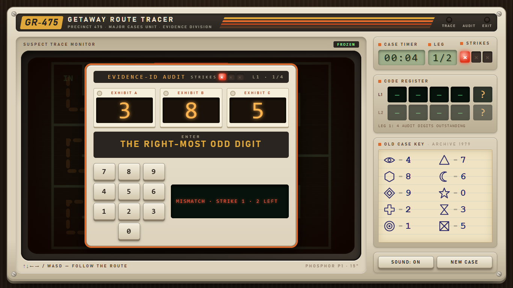

# The Getaway Route

A PSY475 escape-room puzzle built on the **task-switching paradigm**. Players track a fleeing suspect through a maze on a retro "route tracer" console, and are repeatedly interrupted, at unpredictable moments, by an **Evidence-ID Audit**. The maze freezes during every audit. Each correct answer prints one digit of the case code. At the exit the suspect leaves a symbol, which players decode with the on-screen **Old Case Key** to get the final digit and close the case.

Styled in **Cassette Futurism**: beige plastic housings, a green-phosphor CRT, chunky keys, indicator lamps, and amber readouts, with a detective/case-file theme.

## Running it (Windows)

Nothing to install. Double-click **`Start Getaway Route.bat`**. It opens `index.html` in your default browser (Chrome or Edge recommended). Press **F11** for full screen.

You can also just double-click `index.html`.

> macOS support is planned for a later version. The app is plain HTML/CSS/JavaScript, so it should already open in a Mac browser, but only Windows has been tested so far.



## How to play

A full mission takes about 5 minutes.

1. Read the case briefing and press **START PRACTICE** (or Enter). Three **practice audits** follow, each with a short briefing and an explanation of the right answer (which exhibit and why). Practice has no strikes; the last practice audit runs on the clock. Then press **BEGIN TRACE** to start for real (the case timer starts here).
2. Move the amber blip with the **arrow keys** or **WASD** from `IN` to the `EXIT`. Every maze puts them at random spots on **opposite edges** (left and right, or top and bottom), with the exit among the edge cells farthest from the start. Each maze has **exactly two routes** to the exit, of similar length and sharing as little as possible, so spotting one route doesn't make it easy.
3. Without warning, an **Evidence-ID Audit** pops up and the maze freezes. Five exhibit digits are shown with a rule, for example *the highest digit*, *the right-most odd digit*, or *the digit that appears twice*. Type the answer on the top-row digits or the numpad (NumLock on or off), or click the on-screen keypad.
   - **Correct:** the digit is printed into the **Code Register** and the maze unfreezes. Audits **keep coming until you reach the exit**. Once a leg's 4 slots are full, each new correct answer **overwrites the oldest slot** (A01, then A02, ...). A blinking orange bar marks the slot that will be overwritten next, and the audit says which slot it will replace. The code is whatever the register shows when you reach the exit.
   - **Wrong, or out of time:** each audit has a **6-second clock** (draining bar). A wrong answer or running out of time is a **strike**, then a new audit. **Three strikes restart the current leg** (new maze, that leg's register row cleared, strikes back to 0). Earlier legs' digits and marks are kept, and the case timer keeps running. Strikes count per leg.
4. **Route errors.** Hitting a wall (once per key press, holding a key doesn't count again) or doubling back along your route (once per retreat, however many steps) is a route error, shown on the **Route Errors** meter. At 10 errors the trail is lost: the maze for that leg **scrambles** into a new one and you restart from `IN`. Audit digits you've earned are kept.
5. Audits are **evenly paced but unpredictable**: after each audit, the next one comes after a fresh random gap of 8 to 16 seconds of maze time. There is no slow start and no build-up, yet players can never tell exactly when the next one is coming.
6. The exit stays **sealed (LOCK)** until the leg's 4 slots have been filled once. Standing at a sealed exit makes the remaining audits come much faster.
7. The mission has **three legs** (three mazes). At each exit the suspect leaves a **mark** (symbol), which is logged in the register.
8. After the last leg, enter the full **15-digit case code** (one row per leg, laid out like the register): the register read left to right, top to bottom, replacing each mark with its number from the **Old Case Key**. The correct code shows **CASE CLOSED** and sends players to the **evidence desk**.


Audit rules in the pool: highest, lowest, middle value (by size, not position: 2 digits are higher and 2 lower), left-most even, right-most even, left-most odd, right-most odd, and the digit that appears twice. Zero counts as even. Every audit has exactly one correct answer.

Rules are dealt like a **deck of cards**: each of the 8 rules is used once before any rule repeats, then the deck is reshuffled (never starting with the rule just used). With a random code (the default) this is exact. With a `fixedCode`, a rule that can't produce the needed digit (for example, an odd rule when the digit is 4) waits in the deck until a later audit.

## Facilitator guide

All settings live in **`js/config.js`**. Edit, save, and reload the browser.

| Setting | Default | What it does |
| --- | --- | --- |
| `rounds` | `3` | Number of legs (mazes) in a mission. |
| `auditsPerRound` | `4` | Audit digits per leg. Code length = rounds × (audits + 1). |
| `fixedCode` | `null` | `null` = new random code every run. Or set a fixed code of the right length, e.g. `"4719238065"`. |
| `mazeWidth` / `mazeHeight` | `31` / `19` | Maze size in cells. |
| `mazeBranching` | `0.6` | 0 to 1. Higher means more junctions and dead ends. |
| `auditGapSeconds` | `[8, 16]` | Seconds of maze time between popups, drawn at random from this range each time. |
| `rushGapSeconds` | `[1, 2.5]` | Gap range once a player waits at a sealed exit. |
| `auditExhibits` | `5` | Digits shown per audit (3 or 5; odd numbers keep "middle value" possible). |
| `routeErrorLimit` | `10` | Route errors before the maze scrambles. `0` turns route penalties off. |
| `penalizeWallHits` | `true` | Wall hits count as route errors. |
| `penalizeBacktracking` | `true` | Doubling back counts as a route error. |
| `auditTimeLimitSeconds` | `6` | Seconds to answer each audit; running out is a strike. `0` = no clock. |
| `practiceAudits` | `3` | Practice audits before the official start. `0` = none (or open `index.html?skippractice`). |
| `maxStrikes` | `3` | Strikes (wrong or timed out) per leg before that leg restarts. |
| `caseKey` | see file | Symbol to digit mapping (each digit 0 to 9 once). |
| `shuffleCaseKey` | `true` | Shuffle the key every run. |
| `successMessage` | evidence desk clue | Text on the Case Closed screen. |
| `failMessage` | see file | Text on the Mission Scrubbed screen. |
| `sound` | `true` | Sound effects (alarms, answers, button clicks) on at start. Toggle with the SOUND button. |

**Between groups:** press **NEW CASE** (or `Ctrl+Shift+N`) for a fresh mission.

**Rehearsal mode:** add `?demo` to the address (for example `index.html?demo`) for tiny mazes and audits every few seconds. A full run takes under a minute.

**Skip practice** (for a group that has already practised): open `index.html?skippractice`.

**Data:** the Case Closed screen shows total time, audits cleared, strikes, mean audit response time, code attempts, and route errors (wall hits, doublings back, scrambles). The same numbers (including every audit response time in ms and the code) are logged to the browser console (F12), which is handy for talking about switch costs in the debrief.

## How it links to the course (task switching)

- Players alternate between two tasks with different goals and response sets: spatial navigation (arrow keys) and numeric judgement (digit keys). Each audit forces a **switch** and a reconfiguration of the task set, and returning to the maze forces another.
- Audits arrive after **random gaps**, so players cannot predict the switch. This removes the benefit of anticipatory preparation and makes switch costs larger, while the even pacing keeps the switching load steady across the whole run.
- Rules are **dealt from a deck**, so the active rule keeps changing and players can't settle into one rule.
- Audits continue until the exit and **overwrite** older digits, so players must keep updating what they hold in working memory instead of filling the register once and forgetting it.
- **Strikes** and the **audit clock** raise the stakes of each switch, so players must balance speed against accuracy (a speed-accuracy trade-off).
- The **practice round** makes sure the first real switch measures attention, not learning the controls.
- **Five exhibits** instead of three raise the working-memory and visual-search load of each audit, which makes the switch more costly.
- **Route errors** push players to plan the route ahead (goal maintenance) instead of trial and error, so an interruption mid-plan hurts more.
- The audit **rule changes every time** (never the same rule twice in a row), so even within the audit task players must update which rule is active, adding a second layer of switching.
- The frozen maze means players must hold their place in memory and **re-orient** after each interruption, a classic resumption cost after task interruption.
- The final step requires integrating information from both tasks (register digits plus the decoded mark).

## Project structure

```
index.html               Console layout and overlays
css/style.css            Cassette Futurism styling
js/config.js             Facilitator settings
js/app.js                Game flow: maze, audits, exit, final code
js/maze.js               Maze generation (growing tree, far exit) and CRT rendering
js/audit.js              Audit question generator
js/route.js              Route-error tracker (wall hits, doubling back)
js/symbols.js            SVG glyphs for the Old Case Key
js/sound.js              Synthesized sound effects (Web Audio)
Start Getaway Route.bat  Windows launcher
Run Tests.bat            Runs all tests (Windows)
tests/unit.test.js       Unit tests: audit rules, generator, maze, route errors
tests/e2e.mjs            End-to-end test in headless Edge/Chrome with real key presses
                         (run only some sections: node tests/e2e.mjs 1 3)
docs/                    Screenshots for this README
```

## Tests

Needs [Node.js](https://nodejs.org) 22 or newer. The end-to-end test also needs Microsoft Edge or Google Chrome (Edge comes with Windows). Double-click **`Run Tests.bat`**, or run:

```
npm test
```

- **Unit tests** check every audit rule against an independently written answer key for **every** possible 3-digit and 5-digit combination, check that generated audits always have the intended answer, that start and exit sit on opposite edges and every maze has exactly two routes of similar length, the rule deck (each rule once per cycle, never twice in a row), and the route-error rules.
- **End-to-end test** opens the real page in a hidden browser and plays it with real key presses. It reads the exhibits and rule off the screen, solves them independently, and answers using the top-row digits, the numpad with NumLock on, the numpad with NumLock off, and mouse clicks. It also checks strikes, mission failure, the final code, wall hits, doubling back, and the maze scramble, then runs 64 more audits as a stress test, checking that rules are dealt in full cycles and that popup gaps stay in range.

## Changelog

- **v0.7** Three strikes now restart only the current leg (earlier legs kept; strikes count per leg). Each audit has a configurable clock (default 6 s); running out is a strike. Three practice audits with briefings and answer explanations before the official start (skippable). Case Closed stats show total strikes, timeouts and leg restarts.
- **v0.6** Random start and exit on opposite edges of each maze. Each maze has exactly two solution routes of similar length that share as little as possible (the shorter route is never more than 10% shorter than the original). Final code entry shows one row per leg, so 3+ legs fit. Config now defaults to 3 legs, branching 0.6 and 10 route errors. Browser test sections can run on their own.
- **v0.5** Audits keep coming until the exit. After a leg's register is full, each correct answer overwrites the oldest slot, so players must re-check the register; the next slot to be overwritten blinks, and the audit shows which slot (and its current digit) it replaces.
- **v0.4.2** Audit popup sound: a tape STOP clunk with the motor winding down, then a warbling alert bell. New exhibits after a wrong answer get a short double chirp instead.
- **v0.4.1** Tape-deck sounds: buttons now make a cassette-deck "ka-chunk" (plastic snap, latch thunk, spring ring, then the key popping back up); BEGIN and NEXT LEG sound like pressing PLAY with the motor spinning up. Maze moves tick like a tape counter (lower tick when doubling back) and wall hits thump. The end-to-end test now also fails on any page error.
- **v0.4** Audit rules are dealt like a deck (each rule once before any repeats). With a random code, each audit is built first and its answer becomes the code digit, so every rule is always available. Popups now come after an even random gap (8 to 16 s) instead of a rising chance, so there is no slow start. Tests cover both.
- **v0.3.1** Button sound effects: a crisp click for keypad keys (on-screen or keyboard) and a heavier latch sound for console buttons.
- **v0.3** Fixed: numpad answers were ignored when NumLock was off (the keys send End/ArrowDown/PageDown instead of digits), which made correct answers look undetected. Audits now show 5 exhibits; "middle value" note now says it means by size, not position. New route errors for wall hits and doubling back; too many scrambles the leg's maze. Added unit and end-to-end tests.
- **v0.2** Random code every run; two legs (10-digit code, two marks); bigger 31×19 maze with more branching and the exit at the farthest point; rising-chance audit popups; three-strike rule that scrubs the mission; Case Closed clue points to the evidence desk; audit clock no longer depends on animation frames.
- **v0.1** First playable version: random maze, random-interval audits with frozen maze, code register, sealed exit, Old Case Key symbol decoding, final code entry, Case Closed stats, Windows launcher.
