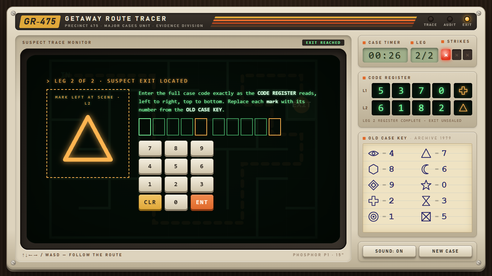

# The Getaway Route

A PSY475 escape-room puzzle built on the **task-switching paradigm**. Players track a fleeing suspect through a maze on a retro "route tracer" console, and are repeatedly interrupted, at unpredictable moments, by an **Evidence-ID Audit**. The maze freezes during every audit. Each correct answer prints one digit of the case code. At the exit the suspect leaves a symbol, which players decode with the on-screen **Old Case Key** to get the final digit and close the case.

Styled in **Cassette Futurism**: beige plastic housings, a green-phosphor CRT, chunky keys, indicator lamps, and amber readouts, with a detective/case-file theme.

## Running it (Windows)

Nothing to install. Double-click **`Start Getaway Route.bat`**. It opens `index.html` in your default browser (Chrome or Edge recommended). Press **F11** for full screen.

You can also just double-click `index.html`.

> macOS support is planned for a later version. The app is plain HTML/CSS/JavaScript, so it should already open in a Mac browser, but only Windows has been tested so far.


## How to play

A full mission takes about 5 minutes.

1. Read the case briefing and press **BEGIN TRACE** (or Enter).
2. Move the amber blip with the **arrow keys** or **WASD** from `IN` (top left) to the exit. The exit is hidden somewhere deep in the maze (always the spot farthest from the start).
3. Without warning, an **Evidence-ID Audit** pops up and the maze freezes. Three exhibit digits are shown with a rule, for example *the highest digit*, *the right-most odd digit*, or *the digit that appears twice*. Type the answer or click the on-screen numpad.
   - **Correct:** the digit is printed into the **Code Register** and the maze unfreezes.
   - **Wrong:** a **strike**, then a new audit. **Three strikes scrub the mission** and it restarts with a new code.
4. Audits use a **rising chance**: right after an audit there is a short quiet period, then the chance of the next popup grows every second until one fires. Players can never tell when the next one is coming.
5. The exit stays **sealed (LOCK)** until the leg's audit digits are collected. Standing at a sealed exit makes the remaining audits come much faster.
6. The mission has **two legs** (two mazes). At each exit the suspect leaves a **mark** (symbol), which is logged in the register.
7. After leg 2, enter the full **10-digit case code**: the register read left to right, top to bottom, replacing each mark with its number from the **Old Case Key**. The correct code shows **CASE CLOSED** and sends players to the **evidence desk**.



Audit rules in the pool: highest, lowest, middle value, left-most even, right-most even, left-most odd, right-most odd, and the digit that appears twice. Zero counts as even. The same rule never appears twice in a row.

## Facilitator guide

All settings live in **`js/config.js`**. Edit, save, and reload the browser.

| Setting | Default | What it does |
| --- | --- | --- |
| `rounds` | `2` | Number of legs (mazes) in a mission. |
| `auditsPerRound` | `4` | Audit digits per leg. Code length = rounds × (audits + 1). |
| `fixedCode` | `null` | `null` = new random code every run. Or set a fixed code of the right length, e.g. `"4719238065"`. |
| `mazeWidth` / `mazeHeight` | `31` / `19` | Maze size in cells. |
| `mazeBranching` | `0.3` | 0 to 1. Higher means more junctions and dead ends. |
| `auditGraceSeconds` | `4` | Quiet time after each audit. |
| `auditChanceRamp` | `0.004` | How fast the popup chance rises (higher = sooner). Default averages roughly 25 s between audits. |
| `auditMaxGapSeconds` | `45` | A popup is guaranteed by this point. |
| `rushMultiplier` | `40` | How much faster audits come once a player waits at a sealed exit. |
| `maxStrikes` | `3` | Wrong audit answers allowed before the mission is scrubbed. |
| `caseKey` | see file | Symbol to digit mapping (each digit 0 to 9 once). |
| `shuffleCaseKey` | `true` | Shuffle the key every run. |
| `successMessage` | evidence desk clue | Text on the Case Closed screen. |
| `failMessage` | see file | Text on the Mission Scrubbed screen. |
| `sound` | `true` | Sound effects on at start (toggle with the SOUND button). |

**Between groups:** press **NEW CASE** (or `Ctrl+Shift+N`) for a fresh mission.

**Rehearsal mode:** add `?demo` to the address (for example `index.html?demo`) for tiny mazes and audits every few seconds. A full run takes under a minute.

**Data:** the Case Closed screen shows total time, audits cleared, strikes, mean audit response time, and code attempts. The same numbers (including every audit response time in ms and the code) are logged to the browser console (F12), which is handy for talking about switch costs in the debrief.

## How it links to the course (task switching)

- Players alternate between two tasks with different goals and response sets: spatial navigation (arrow keys) and numeric judgement (digit keys). Each audit forces a **switch** and a reconfiguration of the task set, and returning to the maze forces another.
- Audits arrive with a **rising random chance** (a hazard function), so players cannot predict the switch. This removes the benefit of anticipatory preparation and makes switch costs larger, while the growing chance keeps tension building the longer they go without one.
- **Strikes** raise the stakes of each switch, so players must balance speed against accuracy.
- The audit **rule changes every time** (never the same rule twice in a row), so even within the audit task players must update which rule is active, adding a second layer of switching.
- The frozen maze means players must hold their place in memory and **re-orient** after each interruption, a classic resumption cost after task interruption.
- The final step requires integrating information from both tasks (register digits plus the decoded mark).

## Project structure

```
index.html               Console layout and overlays
css/style.css            Cassette Futurism styling
js/config.js             Facilitator settings
js/app.js                Game flow: maze, audits, exit, final code
js/maze.js               Maze generation (growing tree, far exit) and CRT rendering
js/audit.js              Audit question generator
js/symbols.js            SVG glyphs for the Old Case Key
js/sound.js              Synthesized sound effects (Web Audio)
Start Getaway Route.bat  Windows launcher
docs/                    Screenshots for this README
```

## Changelog

- **v0.2** Random code every run; two legs (10-digit code, two marks); bigger 31×19 maze with more branching and the exit at the farthest point; rising-chance audit popups; three-strike rule that scrubs the mission; Case Closed clue points to the evidence desk; audit clock no longer depends on animation frames.
- **v0.1** First playable version: random maze, random-interval audits with frozen maze, code register, sealed exit, Old Case Key symbol decoding, final code entry, Case Closed stats, Windows launcher.
